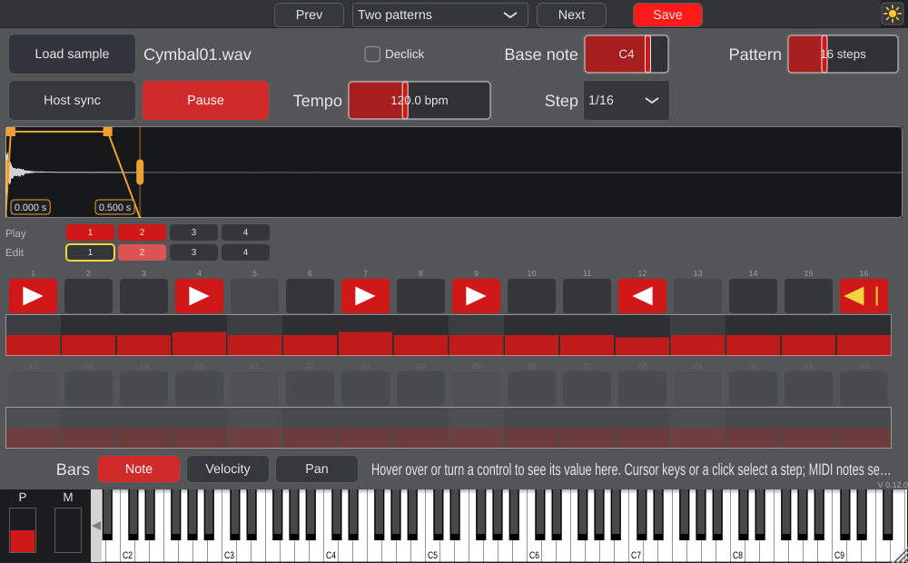
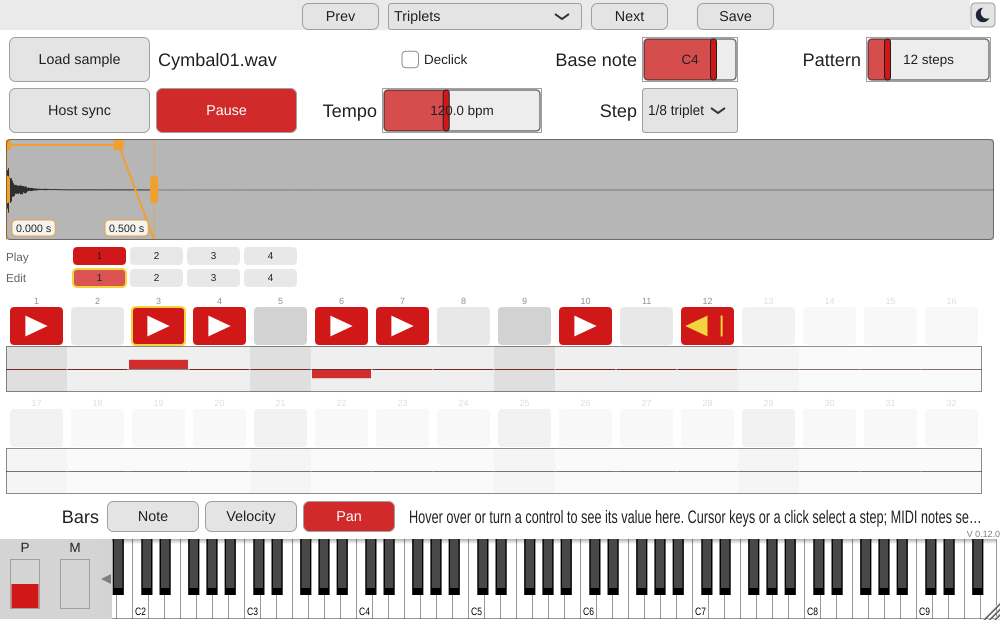

# DrumFeatureDemonstrator

A free **one-sample drum instrument** (VST3, AU, Standalone) for Windows, macOS and Linux with a
1/16 step grid and one new idea: **play to end**. Put the mode on the last step before a beat, and
a reversed cymbal is started early enough that it **ends exactly at the end of that step** --
at any pitch, at any tempo, in sync with your DAW. No more nudging reverse cymbals by hand.

Developed at the [Jade Hochschule](https://www.kvraudio.com/developer/jade-hochschule)
(Jörg Bitzer) as a demonstrator for this feature and as a teaching example for students and young
engineers. Free, open source, no commercial interest. **Vibe-coded with an AI** -- see
[How it was made](#how-it-was-made).

| Night theme: "Two patterns" (pattern 2 edited, pattern 1 playing) | Day theme: "Four patterns", pan page |
|---|---|
|  |  |

## Download

Binaries for Windows, macOS (Universal: Apple Silicon and Intel) and Linux are built by GitHub
Actions and published on the
[GitHub Releases page](https://github.com/JoergBitzer/DrumFeatureDemonstrator/releases) when a version
is released. Each zip contains the plugin, the Standalone application, the manual (PDF), a
`ReadMeFirst.txt` and the licenses.

Install by copying the plugin into your plugin folder and rescanning in your DAW (in Cubase:
*Studio > VST Plug-in Manager*, then add an *Instrument Track* and choose DrumFeatureDemonstrator):

| | VST3 | AU |
|---|---|---|
| Windows | `C:\Program Files\Common Files\VST3\` | -- |
| macOS | `~/Library/Audio/Plug-Ins/VST3/` | `~/Library/Audio/Plug-Ins/Components/` |
| Linux | `~/.vst3/` | -- |

The macOS binaries are not signed with an Apple Developer ID yet. If macOS reports that the plugin is
damaged or cannot be opened, remove the quarantine flag in the Terminal, e.g.
`xattr -cr ~/Library/Audio/Plug-Ins/VST3/DrumFeatureDemonstrator.vst3`.

The Standalone version runs without a DAW (play the sample from the on-screen keyboard, or with its own
beat and the space key).

## Features

### Play to end
For a step in the mode *reverse + play to end* the plugin computes how long the sample sounds at the
chosen pitch,

    duration d = N / r,     r = 2^(p/12) * f_file / f_host

(N samples of the played region, p the step note minus the base note in semitones), and starts the
sound at *end of the step - d*. Because the pattern repeats and d is at most one pattern long, the start
lies in the pass before; the plugin looks ahead. The beat position, the tempo and the play state come
from the DAW (`AudioPlayHead`), so it stays in sync. If the start time has already passed (the transport
starts or jumps into the run-up) the sound is not played and a notice tells why.

### The instrument
- **One sample**, loaded with a button, by dropping a file onto the plugin (also in hosts that embed the
  window, see below) or from a project/preset. Plain resampling: pitch and duration change together.
- **Waveform** with start and end line (times shown in seconds), a **fade-in and fade-out** handle at the
  top (the orange line is the envelope), and a **Declick** switch that snaps the lines to zero crossings.
- **Four patterns** of 8 to 32 steps (the same length for all): switch each pattern on or off for playback (the ones that
  are on are played one after the other, 1 to 4), choose which one you edit; a yellow frame marks the pattern that plays.
- **Step grid**: one button per step with four states (off, forward, reverse, reverse + play to end) and, below, a row of
  vertical **bars** whose *page* you choose: **note** (MIDI note), **velocity** (MIDI value) or **pan**; **draw over the bars** with
  the mouse and every bar you cross follows the line. The **base note** (C1 - C5) is where the sample sits in the scale.
- **Step note value** from 1/1 to 1/64, normal, dotted or as a triplet (default 1/16).
- **Host sync** (follows tempo and position of the DAW) or an **internal beat** with Play/Pause and the space key.
- **MIDI keyboard** and MIDI input play the sample with pitch and velocity. While the transport stands, the
  selected step (yellow frame; cursor keys or a click select it) takes the note and velocity of what you play.
- **Info line** with the value of the control under the mouse (no room for an edit field per bar).
- **Presets**: all four patterns, region, fades and the sample name; seven factory presets (they keep your sample).
  A DAW project contains the sample itself (up to 8 MB), so it works without the samples folder.
- Day and night theme, resizable window. The base note, start/end, fades, pattern length, step note value and the tempo controls are
  host parameters (automatable); the patterns themselves (steps, notes, velocities, pans, play switches) are not parameters but data
  that is saved in presets and DAW projects, so they cannot be automated. The red *Save* button shows every change.

### Drag and drop on Linux
Hosts such as Bitwig embed the plugin window in a window of their own that does not accept file drops. The
plugin therefore announces its own small drop target for that window (X11 `XdndProxy`), see
[src/platform/XdndTarget.h](src/platform/XdndTarget.h). On Windows and macOS the normal drop of the system is used.

## Manual
The manual is [docs/manual/ManualDrumFeatureDemonstrator.pdf](docs/manual/ManualDrumFeatureDemonstrator.pdf)
(LaTeX source and the list of controls next to it).

## How it was made

To be honest: DrumFeatureDemonstrator is **vibe-coded**. The code was written by an AI, Anthropic's Claude
(in Claude Code), in conversation with Jörg Bitzer, on top of the
[AdvancedAudioTemplate](https://github.com/JoergBitzer/AdvancedAudioTemplate) (branch AAT2):

- **Planning first.** [planning.md](planning.md) holds the idea, every decision with its date and the work
  packages; questions were answered by the author before code was written.
- **Step by step, every step a branch.** Each feature or fix is a git branch, merged with a merge commit and
  tagged `state-<version>`, so every state can be checked out again. What happened, what was measured and what
  was decided without asking is written down in [DEVELOPMENT_LOG.md](DEVELOPMENT_LOG.md).
- **Human review and usage tests.** The author tried the builds in a DAW (Bitwig on Linux) and his findings
  changed the plugin: the note-based pitch, the info line, the step cursor, the keyboard labels, the slider look,
  the fades and the drag and drop.
- **Tests by the AI:**
  - unit tests of the pure code (scheduler, sequencer, sample engine, sample store; `ctest`), including an
    end-to-end test that a reversed sound ends within one resampling step of the end of its step, for several
    pitches and sample rates, and a check that rendering does not allocate memory;
  - renders through the real plugin code with the `Tester` (`render`, `snapshot`, keys, drops, state save/restore),
    analysed with Python: e.g. with a MusicRadar cymbal at 120 bpm the reversed sounds end at 1.0000, 2.0000,
    3.0000 and 4.0000 s;
  - [pluginval](https://github.com/Tracktion/pluginval) at strictness level 10;
  - real mouse input and a real GTK drag source (XTest) on the Standalone and on the author's running
    Bitwig window to find and fix the drag and drop problem.

What this does not replace: only Linux (Bitwig, Standalone) was used by a human; Windows and macOS are built and
checked by the CI only (pluginval, on macOS also auval), and there was no formal listening test. Feedback is welcome.

## Build from source

The plugin uses [JUCE 9](https://juce.com) (9.0.3, included as a git submodule) and CMake:

```console
git clone --recursive https://github.com/JoergBitzer/DrumFeatureDemonstrator.git
cd DrumFeatureDemonstrator
cmake -S . -B build -DCMAKE_BUILD_TYPE=Release
cmake --build build --config Release --target DrumFeatureDemonstrator_VST3 DrumFeatureDemonstrator_Standalone
# macOS additionally: --target DrumFeatureDemonstrator_AU
```

On Linux the JUCE dependencies are needed (ALSA, X11, freetype, ...; see
[.github/workflows/release.yml](.github/workflows/release.yml) for the package list). Develop with the Debug build
(JUCE assertions are on); the unit tests and the test tool are optional:

```console
cmake -S . -B build -DCMAKE_BUILD_TYPE=Debug -DAAT_BUILD_TESTER=ON -DDFD_BUILD_UNIT_TESTS=ON
cmake --build build --parallel 4 --target DrumFeatureDemonstrator_UnitTests DrumFeatureDemonstrator_Tester
ctest --test-dir build --output-on-failure
tools/run_pluginval.sh build/DrumFeatureDemonstrator_artefacts/Debug/VST3/DrumFeatureDemonstrator.vst3
```

Drum samples for tests (not in the repository, free and royalty-free from MusicRadar's SampleRadar):
`tools/fetch_samples.sh`. Example:
`DrumFeatureDemonstrator_Tester render - out.wav --sample cymbal.wav --note 60,100,0.5 --seconds 4`.

**Releases** are built by GitHub Actions ([.github/workflows/release.yml](.github/workflows/release.yml)): pushing a
tag `vX.Y.Z` that matches the version in `CMakeLists.txt` builds Windows, macOS and Linux, tests with pluginval
(and auval) and creates a GitHub release with the zips. "Run workflow" on the Actions page builds without releasing;
the zips are attached to the workflow run.

## For students and developers

| Folder / file | Content |
|---|---|
| [planning.md](planning.md), [DEVELOPMENT_LOG.md](DEVELOPMENT_LOG.md) | plan, decisions, progress; log of the development with results and findings |
| [docs/design/W2-play-to-end.md](docs/design/W2-play-to-end.md) | the play-to-end algorithm |
| `src/` | the algorithm without GUI code: `StepScheduler` (pure scheduling incl. play to end and the chain of four patterns), `Sequencer` (transport, internal clock), `VoiceBank` / `SampleVoice` (resampling playback, fades), `SampleHolder` (lock-free hand-over), `SampleStore` (samples folder, project state), `StepParameters`, `NoteNames` |
| `src/platform/` | `XdndTarget`: file drops into a host window on Linux (plain Xlib) |
| `gui/` | `WaveformView`, `StepGrid`, `PatternSelector` |
| `src/PatternData.*` | the four patterns as lock-free data (no host parameters), saved as one blob (format in the header) in the plugin state |
| `DrumFeatureDemonstrator.*`, `Plugin*.*` | parameters, audio glue, main GUI, editor (from the template) |
| `tests/` | unit tests (`juce::UnitTest`, CTest); `tests/manual/` small tools to test drag and drop by hand |
| `tools/` | template helpers (preset handler, day/night look, pluginval scripts), the `Tester`, `fetch_samples.sh`, `make_factory_presets.py` |
| `res/presets/` | factory presets (generated) |
| [docs/manual/](docs/manual/) | manual (LaTeX and PDF) |

## License

- **Source code of this repository: [MIT License](LICENSE)**, (c) Jörg Bitzer, Jade Hochschule.
- **Plugin binaries:** they contain third-party code:
  - [JUCE 9](https://github.com/juce-framework/JUCE), used under the
    [AGPLv3](https://www.gnu.org/licenses/agpl-3.0.html) (JUCE is dual-licensed AGPLv3 / commercial JUCE licence).
    Therefore the binaries as a whole are distributed under the **AGPLv3** (full text:
    [LICENSE-AGPL-3.0.txt](LICENSE-AGPL-3.0.txt)); the complete source code is this repository plus JUCE.
  - the VST3 SDK by Steinberg (bundled with JUCE 9; MIT License) -- VST is a registered trademark of
    Steinberg Media Technologies GmbH;
  - the Audio Unit SDK by Apple (Apache License 2.0, macOS AU only).
- The manual is licensed under CC-BY 4.0. The example samples of the screenshots come from MusicRadar's
  SampleRadar (royalty-free) and are not part of this repository.

MIT code may be combined with AGPLv3/GPLv3 code; the MIT license of the files in this repository stays as it is.
The plugin comes without any warranty (see the licenses).
